# Konsole Matrix Digital Rain

  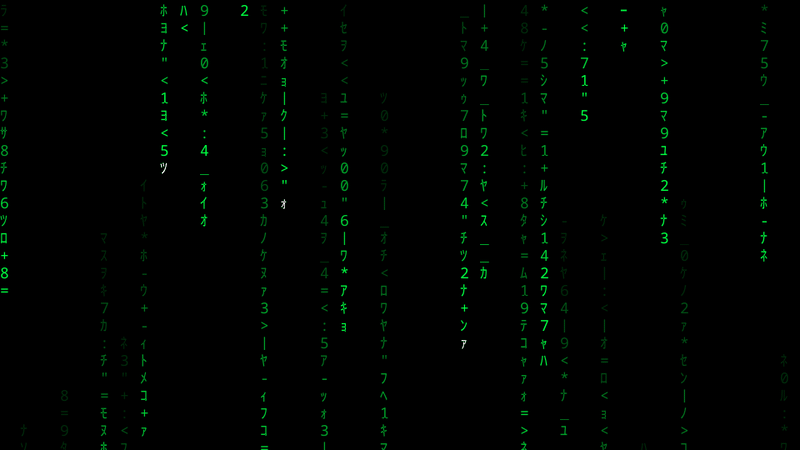

Cinematic Matrix digital rain for Fedora/KDE — in Konsole, across every
monitor, and natively on the real KDE lock screen. One small, inspectable,
user-level utility: configurable palettes and presets, exact hue selection,
a customizable hue cycle, synchronized multi-monitor rainfall, an idle-aware
saver controller, and an animated Plasma 6 lock-screen wallpaper with
verified display-off suspension and adaptive resource protection.

Konsole Matrix Digital Rain is an independent open-source project and is not
affiliated with, sponsored by, or endorsed by the creators or rights holders
of *The Matrix*. “The Matrix” and related marks belong to their respective
owners.

## Gallery

Every capture below is genuine program output from this repository's code on
Fedora/KDE Plasma 6 (Wayland). The lock-screen images were taken in the stock
KDE greeter's test mode (`kscreenlocker_greet --testing`); the animation at
the top was captured from the renderer running in a plain test window.

| | |
| --- | --- |
| 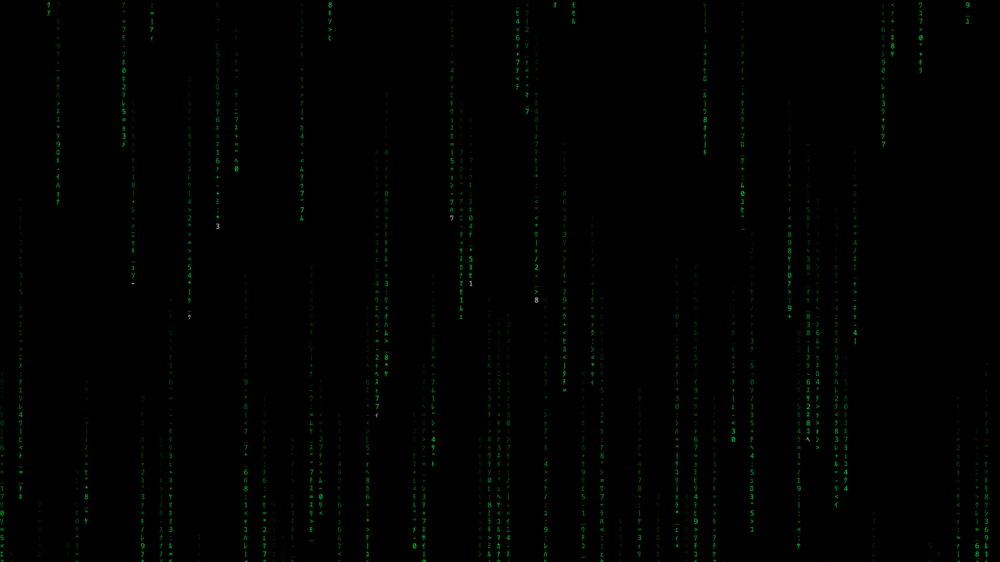 | 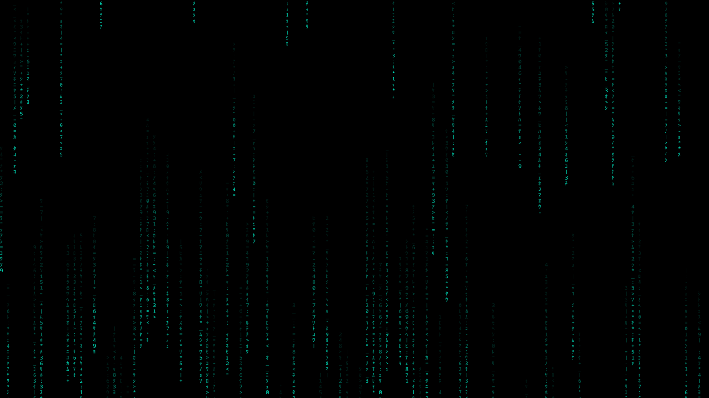 |
| The animated lock screen, classic green with white stream heads. | The same screen with an exact user-chosen hue (`#00ffdd`) and cycling. |

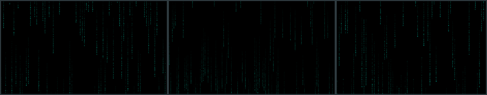
*Three displays (1080p, 1440p, and a fractionally scaled laptop panel), each
running its own independent rainfall while hue stays synchronized through a
shared wall-clock phase — no IPC, no daemon.*

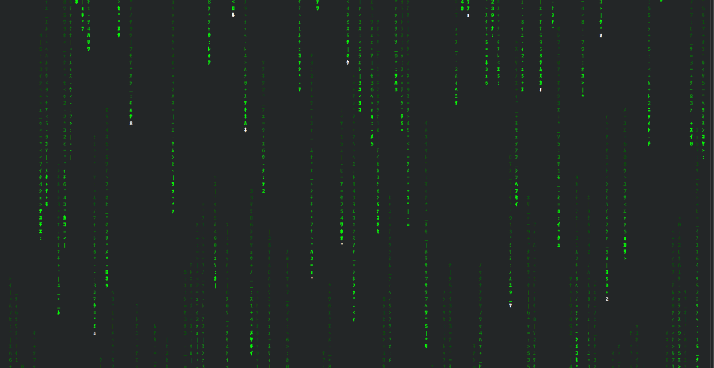
*The terminal renderer in Konsole (`matrix --preset cinematic`).*

## Colors & Hue Variations

The rain can take any color. The terminal renderer offers the named colors
`green`, `red`, `blue`, `white`, `yellow`, `cyan`, and `magenta`
(`matrix --color blue`) plus hue cycling with live hue hold; the lock-screen
renderer accepts any exact HEX color or hue degree
(`matrix-lock set color "#8b5cf6"`, `matrix-lock set hue 270`). Every tile
below is real renderer output, captured from the GPU lock-screen renderer in
a plain test window at the exact HEX shown — shades beyond the named
terminal colors (such as orange, purple, and pink) are custom hue
selections, not built-in presets.

| | |
| --- | --- |
| 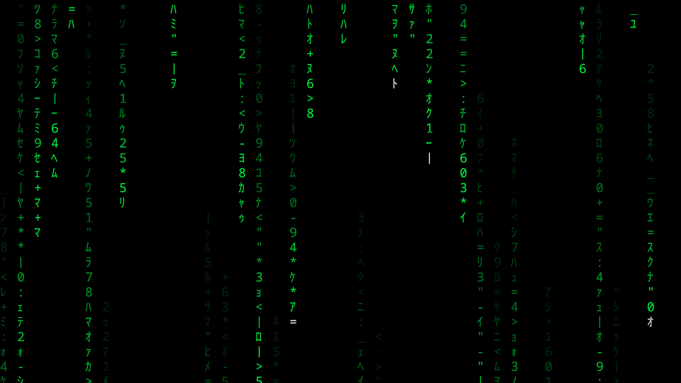 | 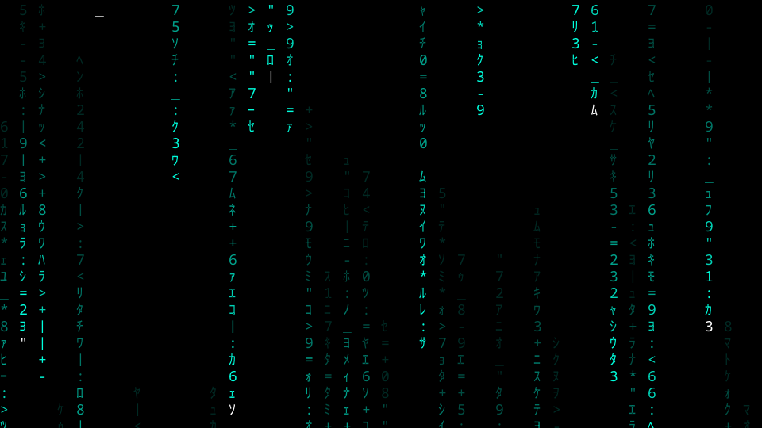 |
| **Green** — `#00ff41` (classic) | **Cyan** — `#00ffdd` |
| 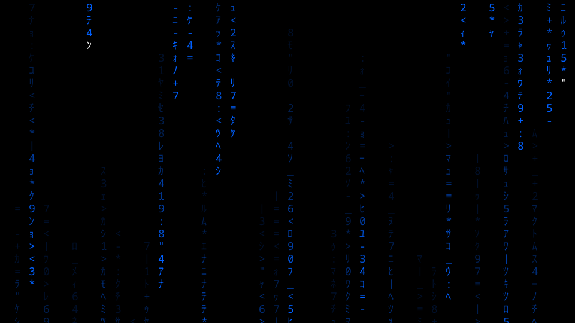 | 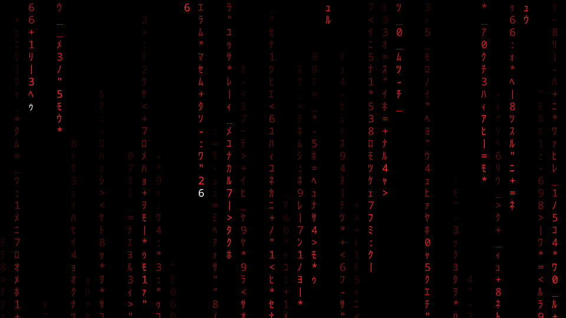 |
| **Blue** — `#0060ff` (also a named terminal color) | **Red** — `#ff2b2b` |
| 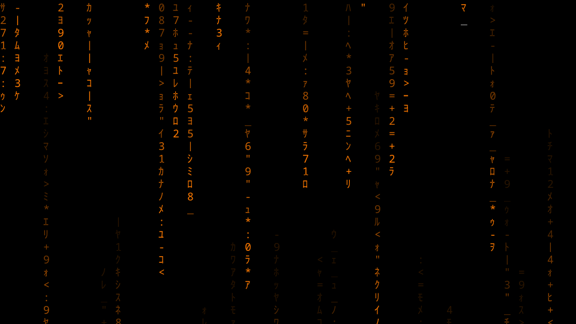 | 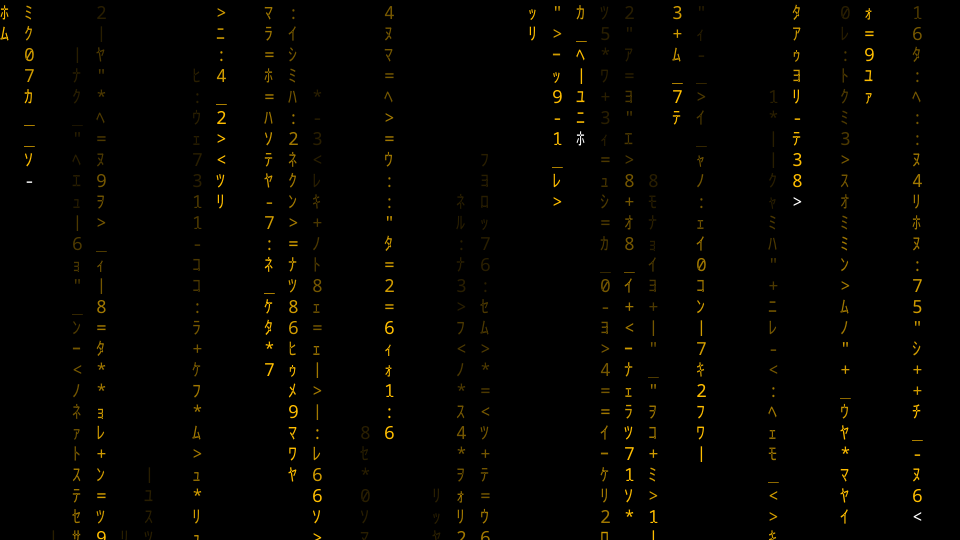 |
| **Orange** — `#ff7a00` (custom hue) | **Yellow** — `#ffbe00` (also a named terminal color) |
| 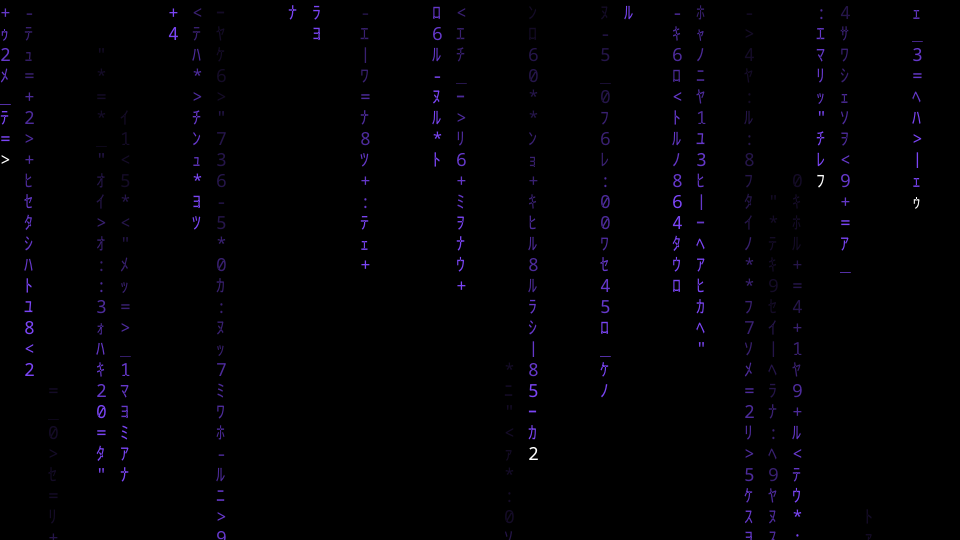 | 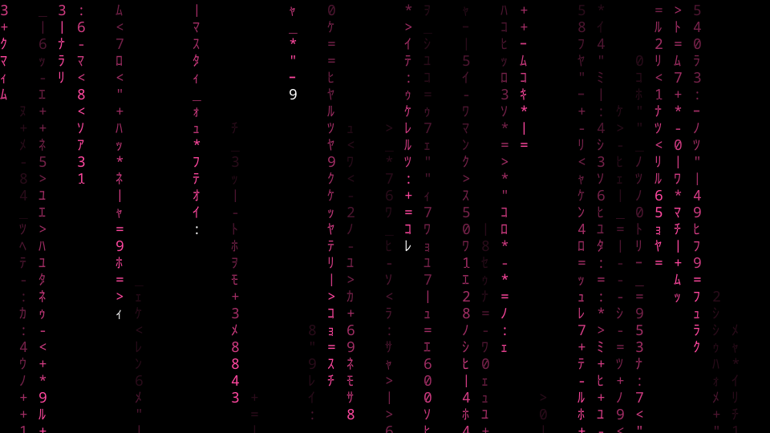 |
| **Purple** — `#8b5cf6` (custom hue) | **Pink** — `#ff4fa3` (custom hue) |

## Background Styles

The terminal renderer supports five background modes —
`matrix --background profile|black|charcoal|white|translucent` (also cycled
live with the `b` key). These are terminal/Konsole features; the lock-screen
renderer uses its own solid background color setting
(`matrix-lock set background "#101010"`) rather than these modes. All four
captures below are real Konsole windows; the translucent capture shows the
project's actual 70%-opacity Konsole profile compositing over a neutral
backdrop window — no edited or layered images.

| | |
| --- | --- |
| 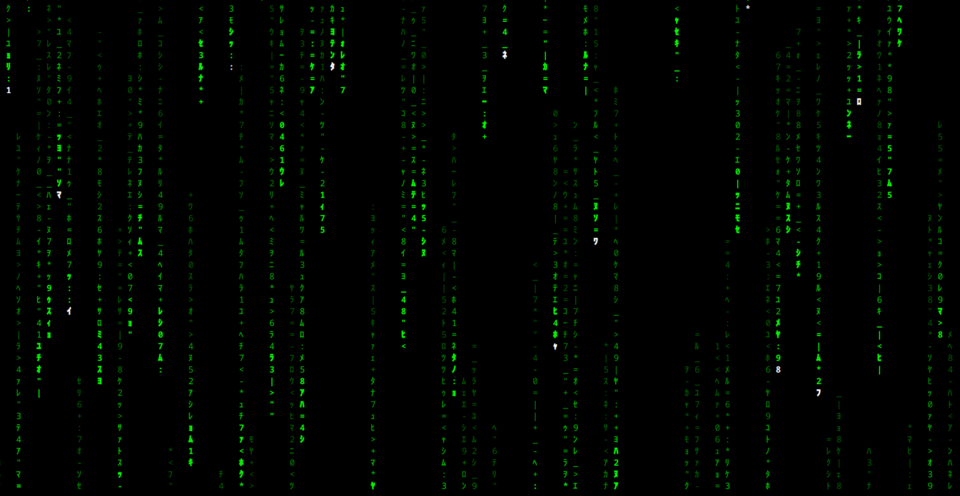 | 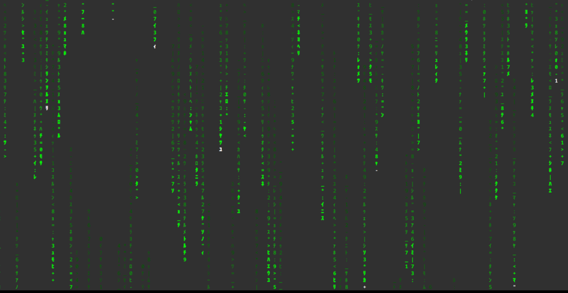 |
| **Black** — pure `#000000` (Matrix Konsole profile default) | **Charcoal** — `#303030` |
| 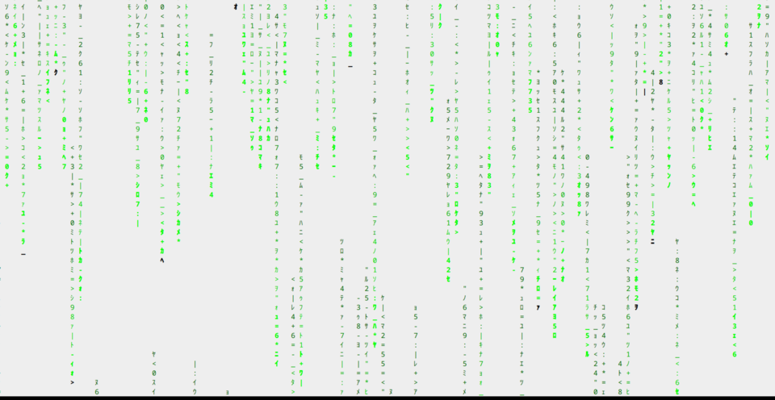 | 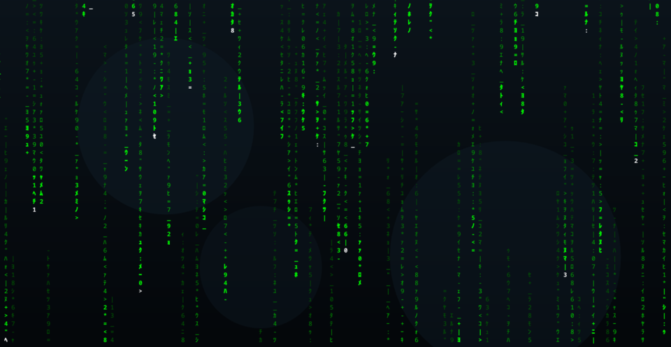 |
| **White** — light background with darker rain | **Translucent** — real compositor transparency (`--background translucent`) |

## Why this exists

I want to share this project out of love for Linux, the Matrix, and all things
in between. It brings the visual experience, KDE integration, and safety
controls together in a small local utility that remains inspectable and
controllable.

## Highlights

**Terminal rain**

- Cinematic green defaults: speed 96, trails 16–38, density 52, six fade
  levels, 75% white heads, and 0.8% glyph mutation.
- Seven direct colors plus a balanced green/cyan, blue, purple/pink,
  red/orange, and yellow/lime cycle.
- Profile, black, charcoal, white, and translucent backgrounds.
- Presets: `cinematic`, `classic`, `ambient`, `dense`, `minimal`, and `cyber`.
- Live controls for color, cycling, speed, hue hold, pause, white heads,
  backgrounds, settings lock, and safe exit handling.
- Independent terminal rain or synchronized multi-monitor rainfall.

**Animated KDE lock screen** (`matrix-lock`)

- Native Plasma 6 wallpaper plugin rendered by the stock KDE greeter; GPU
  shader renderer with terminal-exact discrete fades, Canvas fallbacks, and
  `balanced`/`high`/`battery` quality presets.
- Exact hue capture (visual or `matrix-lock set color "#8B5CF6"`), named
  presets with friendly names, bounded revision history with undo, and a
  customizable hue cycle with excluded spectrum ranges bridged by smooth
  crossfades.
- Verified power behavior: rain suspends completely while displays are off,
  and adaptive resource protection freezes the animation while the whole
  system is overloaded.
- Safe enable/disable with automatic wallpaper backup and rollback; never
  touches KScreenLocker, PAM, SDDM, or password entry.

**Safety and housekeeping**

- Optional Plasma stock Hide Cursor integration with stale-state recovery.
- Optional user-level systemd saver service that is installed but never
  enabled automatically.
- Explicit `visual-only`, `immediate`, and secure `after` saver modes.
- Atomic private configuration, runtime state, presets, and install manifests.

## Supported environment and requirements

The supported target is Fedora Linux with KDE Plasma, Konsole, Python 3.11 or
newer, Bash, and a 256-color terminal. The optional integrations use
`kscreen-doctor`, `gdbus`, `loginctl`, and user-level systemd. The ordinary
renderer uses only the Python standard library.

The saver and multi-monitor modes require a live KDE session for their real
behavior. Static checks and automated tests do not require a graphical session
or a running service.

## Installation

Inspect the public source repository first:

    git clone https://github.com/Dev-DDimitrov/Konsole-Matrix-Digital-Rain.git
    cd Konsole-Matrix-Digital-Rain
    scripts/install.sh --dry-run
    scripts/install.sh

The dry run validates the source tree and shows intended user-level targets.
The installer copies managed launchers, Python modules, Konsole assets, and
the optional user unit. It preserves an existing user configuration, creates
private backups for replaced managed files, and never enables the saver
service.

## Commands

| Command | Purpose |
| --- | --- |
| `matrix` | Run rain in the current terminal. |
| `matrix-konsole` | Open a dedicated Matrix Konsole window. |
| `matrix-full` | Open one UI-free fullscreen display. |
| `matrix-all` | Open synchronized fullscreen windows across enabled displays. |
| `matrix-preview` | Preview a palette or preset in a normal Konsole window. |
| `matrix-saver` | Run the idle-aware visual and secure saver controller. |
| `matrix-lock` | Configure the animated Matrix KDE lock-screen wallpaper. |
| `matrix-settings` | Inspect and manage global visual defaults. |
| `matrix-preset` | Save and manage local visual presets. |
| `matrix-doctor` | Run read-only Fedora/KDE/Matrix diagnostics. |
| `matrix-guide` | Show the generated command and control reference. |
| `matrix-help` | Alias for `matrix-guide`; supports the same options. |

See [CONTROLS.md](CONTROLS.md), [GUIDE.md](GUIDE.md), and the executable
`matrix-guide` for the complete current control surface.

## Rainfall, palettes, and presets

Ordinary `matrix` uses the current terminal profile background by default.
Dedicated Matrix Konsole launchers use an opaque black background unless
`--background translucent` is selected. The translucent profile is a
Matrix-owned Konsole asset with 70% opacity.

Use `--preset cinematic`, `--preset classic`, or another built-in preset to
select a visual starting point. User presets are visual-only TOML files under
`${XDG_CONFIG_HOME:-$HOME/.config}/konsole-matrix-digital-rain/presets/`. They never save global
animation pause state.

The ordinary renderer advances each rainfall stream independently. `matrix-all`
shares visual settings, controls, hue state, pause state, and exit state across
its windows while each display continues its own rain simulation.

## Animated KDE lock screen

`matrix-lock` manages a native Plasma 6 wallpaper plugin
(`io.github.devddimitrov.matrixrain`) that renders live Matrix rain behind
KDE's real lock screen. Every monitor runs its own independent rainfall while
color and hue cycling stay synchronized across displays through a shared
wall-clock phase. The lock-screen profile is fully independent from the
terminal profile and defaults to the `balanced` quality preset: a GPU shader
renderer stepping at terminal pace (speed 96, 30 FPS cap, 25% white heads,
flashes off). `matrix-lock quality balanced|high|battery` switches the
rendering bundle without touching colors or hue settings.

The core workflow:

    matrix-lock configure          # live terminal preview; adjust with normal Matrix keys
    matrix-lock preview --greeter  # safe real-greeter test (no input grab)
    matrix-lock enable             # backs up the previous wallpaper, then activates
    matrix-lock disable            # restores the previous lock wallpaper

### Exact hues, history, and undo

Exact hue selection works both visually (press `c` to cycle, `h` to hold the
perfect hue, then save) and numerically (`matrix-lock set hue 270`,
`matrix-lock set color "#8B5CF6"`). Every save keeps a bounded revision
history: `matrix-lock history`, `matrix-lock undo`, and
`matrix-lock restore REV` provide reversible configuration rollback, separate
from installation rollback. `matrix-guide --lock` documents the full surface.

### Customizing the hue cycle

The automatic hue cycle is customizable: unwanted spectrum ranges can be
excluded, and the retained endpoints are bridged by a short, smoothstep-eased
linear-light crossfade (the omitted range is never traversed; a crossfade
briefly passes through desaturated midpoints rather than foreign hues).
Visually, run `matrix-lock configure`, enable cycling with `c`, press `x`
when the unwanted range begins and `x` again when it ends — `u`/`U` undo and
redo any visual edit (session-local, bounded, cleared by a new edit after
undo), `X` clears all exclusions, and `r` resets the whole editing session;
nothing persists until saving. Numerically: `matrix-lock cycle exclude add
45 105` (hue degrees map exactly onto the cycle; `--phase` takes exact 0-1
positions, `--blend` sets the crossfade seconds), plus `list`, `remove ID`,
`enable`/`disable ID`, `set-blend ID SECS`, `clear`, and `matrix-lock cycle
reset` — every change records a history revision, so `matrix-lock undo`
reverses it. Exclusions are visual state: presets carry them, reverse
cycling honors them, all monitors derive the identical blended path from the
exported configuration, and the GPU renderer's per-tick cost is unchanged
(the path is precomputed once per configuration change).

### Named presets

Favorite looks become named presets: `matrix-lock preset save "Neon Purple"`
captures the current visual configuration — exact HEX color or hue-cycle
state, pacing, density, trails, white heads, fades, mutation, flashes,
background, and render mode — under a friendly name (stored atomically as
`lock-presets/neon_purple.toml`, kept through reinstalls and independent of
the bounded history). `preset list` shows built-in and user presets
separately, `show`/`apply`/`rename`/`delete` manage them, applying records a
history revision (`matrix-lock undo` restores the previous appearance), and
built-ins are read-only. Presets never contain resource-protection settings,
so applying one cannot change the adaptive guard. Ending a
`matrix-lock configure` session offers saving the captured look as the
active configuration, a named preset, or both; `matrix-lock configure
--preset NAME` opens a saved preset for live editing and offers updating it
(with confirmation), forking it, applying it, or discarding — the stored
preset is untouched until a save is confirmed.

### Rendering and power behavior

Rendering differences are disclosed rather than hidden: the default `auto`
render mode draws through a GPU fragment shader (a white glyph atlas plus a
per-cell state texture) with the terminal's exact discrete fade levels, and
falls back to a Canvas renderer if shader compilation fails;
`matrix-lock set render-mode low-power` selects a cheaper Canvas path that
fades trails continuously and skips mutation flashes. Terminal previews
approximate exact HEX colors with the nearest spectrum hue; the lock screen
itself shows the exact color. Simulation and rendering gate on the window's
frame-presentation heartbeat (`frameSwapped`): when the compositor stops
completing frames for a display — DPMS off, lid closed, or the surface
unmapped — that monitor's rain stops stepping within about 1.5 seconds and
resumes automatically on the first presented frame after wake. Measured on
Plasma 6.7/Qt 6.11 across a DPMS off/on cycle, greeter CPU drops from ~30%
of one core (three displays, balanced) to 0.0% while displays are off.

### Adaptive resource protection

Adaptive resource protection (on by default) additionally freezes the
current frame while the whole system is overloaded: aggregate CPU or
memory-in-use at or above 85% sustained for ~8 seconds (memory pressure
stalls count too), resuming after both fall to 70% or below for 10 stable
seconds. CPU is derived from `/proc/stat` counter deltas and memory from
`MemAvailable`, sampled once per 5 seconds by a single shared poller per
greeter process (measured 0.03% of one core) that itself pauses while
displays are off. The terminal renderer honors the same `[resource_guard]`
settings from `config.toml` and reuses its pause bookkeeping, so hue and
animation freeze together, a manual pause is never overridden, and a manual
resume during overload snoozes the guard until the system has calmed.
Thresholds are configurable (`matrix-lock set resource-guard off`,
`guard-cpu-pause`, `guard-mem-pause`, `guard-cpu-resume`,
`guard-mem-resume`, `guard-pause-secs`, `guard-resume-secs`);
`matrix-lock doctor` reports a live reading.

### Security boundary and recovery

The plugin never touches KScreenLocker, PAM, SDDM, or password entry; it is
wallpaper only, configured through `kscreenlockerrc` and rendered by the
stock KDE greeter. KDE's password prompt renders above the wallpaper, so a
wallpaper failure cannot block authentication. If the lock screen ever looks
wrong, the recovery path is: switch to a TTY (Ctrl+Alt+F3), log in, run
`matrix-lock disable` to restore the previously recorded wallpaper, and
switch back (Ctrl+Alt+F1 or F2); `scripts/uninstall.sh` removes the plugin
entirely. Neither path touches authentication.

## Saver and KDE security behavior

The concise modes are:

    matrix-saver visual-only
    matrix-saver immediate
    matrix-saver after

`visual-only` returns to the unlocked desktop. `immediate` hands off to
`loginctl lock-session` without launching a visual child. `after` shows Matrix
first, then performs the real KDE lock handoff after the configured delay or
when the visual session exits early. Use `--dry-run` to inspect the policy
without starting windows or locking.

KDE/kscreenlocker remains the authentication boundary. Ordinary Konsole
windows are not represented as a lock-screen-native visual and do not remain
above a secure lock screen after locking.

## Settings and uninstall

Configuration precedence is CLI option, selected preset, user configuration,
then built-in defaults. `matrix-settings show|get|set|reset|path` manages
global defaults with atomic updates.

Preview removal with:

    scripts/uninstall.sh --dry-run

Uninstall removes only unchanged files recorded in the private install
manifest. Modified managed files, user configuration, and presets are
preserved by default. Purging user data is a separate explicitly confirmed
operation: `--purge-user-data --yes`.

## Privacy and security

The utility is user-level only. It has no runtime network requirement,
telemetry, analytics, updater, cloud dependency, password handling, or hidden
remote-execution mechanism. Configuration is data rather than shell code.
Runtime state and mutable settings use restrictive permissions and atomic
updates. See [SECURITY-MODEL.md](SECURITY-MODEL.md) and
[SECURITY.md](SECURITY.md).

Known limitations include the lack of a reliable cross-session idle-inhibitor
enumeration API in the target KDE environment, best-effort cursor hiding from
the stock Plasma effect, and the requirement for a real KDE session for live
window and lock behavior.

## Development and documentation

The public source tree is organized as follows:

- `bin/` — runtime launchers and Python implementations.
- `config/` — non-destructive example configuration.
- `docs/media/` — curated genuine screenshots and demo captures.
- `konsole/` — Matrix-owned Konsole profiles and color schemes.
- `scripts/` — user-level install and uninstall scripts.
- `systemd/` — optional user service unit.
- `tests/` — portable regression and safety tests.

See [ARCHITECTURE.md](ARCHITECTURE.md), [CONTROLS.md](CONTROLS.md),
[GUIDE.md](GUIDE.md), [INVENTORY.md](INVENTORY.md),
[CONTRIBUTING.md](CONTRIBUTING.md), [CHANGELOG.md](CHANGELOG.md), and
[RELEASE-READINESS.md](RELEASE-READINESS.md). The initial public release was
v0.9.0; the changelog records what each release added.

## Validation

Automated and CI-safe checks require no graphical Plasma session, real screen
locking, service enablement, privileged operations, or external UniMatrix copy:

    for f in bin/* scripts/*; do
        first=$(head -n 1 -- "$f" 2>/dev/null || true)
        case "$first" in '#!'*bash*|'#!'*sh*) bash -n -- "$f" ;; esac
    done
    PYTHONDONTWRITEBYTECODE=1 python3 -m unittest discover -s tests -p 'test_*.py' -v

The staging test exercises dry-run installation, isolated installation, and
manifest-based uninstall behavior in a temporary home. ShellCheck runs in CI
when the Fedora runner installs it. Live Konsole, display-topology, cursor,
and KDE lock behavior remain manual graphical acceptance tests;
[RELEASE-READINESS.md](RELEASE-READINESS.md) records which of them have been
performed for the current release candidate. The optional upstream
provenance check is documented in [CONTRIBUTING.md](CONTRIBUTING.md) and is
not part of the default suite.

## Upstream attribution and license

The renderer in `bin/matrix_renderer.py` contains substantially modified and
derived work based on [UniMatrix](https://github.com/will8211/unimatrix) by
William Mannard. UniMatrix is released under the GNU General Public License,
version 3 or any later version. UniMatrix also states that it is based on
CMatrix by Chris Allegretta and Abishek V. Ashok; see
[THIRD_PARTY_NOTICES.md](THIRD_PARTY_NOTICES.md) for the project’s provenance
details.

This project is released under [GPL-3.0-or-later](LICENSE). The external
installed UniMatrix executable is not bundled, copied, modified, or managed by
this repository. Upstream fonts, screenshots, and media are not redistributed;
everything under `docs/media/` was captured from this project's own output.

Contributions must preserve applicable upstream attribution and license
notices. See [CONTRIBUTING.md](CONTRIBUTING.md).
